# Recon Drone

**A low cost two wheeled ground drone that finds people on its own, even when they are lying down, partly hidden or in the dark. All the AI runs on board.**

UTS 41030 Engineering Capstone, Abael Joseph. Supervisor: Dr. Raphael Falque.

  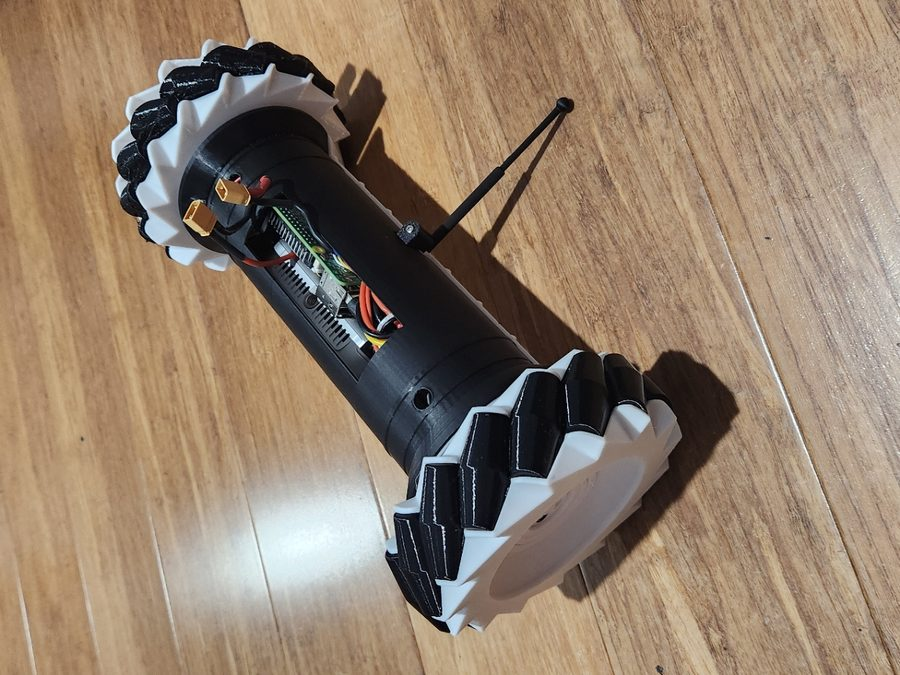
  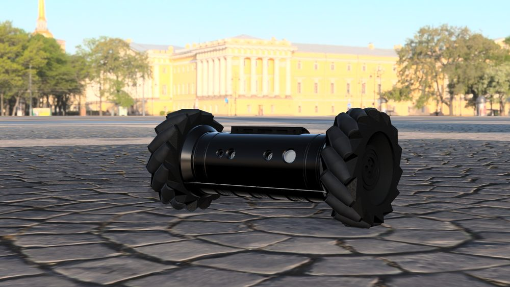

| | |
|---|---|
| **Finds hidden people** | 98.2 to 98.6% of frames, under blankets and behind furniture |
| **False alarms** | 0 in an empty room with the fused detector |
| **Speed** | 30 FPS on the Pi 5 processor, no AI accelerator |
| **Distance accuracy** | Within 0.04 m from 1 to 3 m |
| **Size and weight** | 267 x 170 x 124 mm, 1049 g |
| **Parts cost** | About AU$519, with the D435 camera supplied |

## Contents

1. [The problem](#the-problem)
2. [The idea in one minute](#the-idea-in-one-minute)
3. [How it works](#how-it-works)
4. [Test results](#test-results)
5. [The build](#the-build)
6. [Project status](#project-status)
7. [What is in this repo](#what-is-in-this-repo)

## The problem

After a disaster, searching a building by hand is slow and risky. A small drone can go in first, but a person still has to watch its video the whole time. Camera AI helps, except most of it is trained on people standing up in good light. A survivor is more likely to be lying down, partly covered and in the dark.

This project asks: can a cheap drone find those people by itself, with no cloud and no AI accelerator?

## The idea in one minute

One detector is not enough, so the drone combines two kinds of sight.

| Step | What happens |
|---|---|
| **1. See in the dark** | The D435 camera films in infrared, lit by the drone's own 850 nm LEDs. It also measures distance. |
| **2. Look for a body shape** | A YOLOv8n pose model finds people from their shape. It is very good at standing and sitting people. |
| **3. Look for body heat** | A thermal camera finds warm blobs, so it still works when the body shape is hidden. |
| **4. Combine the two** | The fused detector keeps a lying pose box only if it overlaps a heat blob, and adds any heat blob the pose model missed. A person must appear in 3 of the last 5 frames to count, which rejects flickers. |
| **5. Tell the operator** | The phone app shows the live feed, buzzes on a new person, and marks them on a map. |

The operator's job changes from watching a video to checking alerts.

  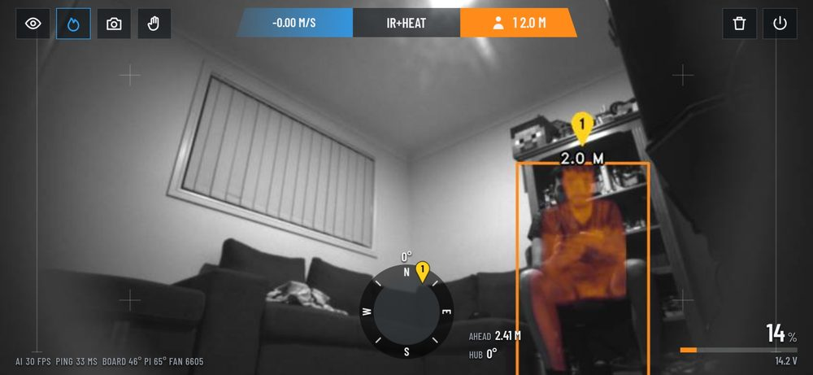
   <em>The phone app: infrared feed with the thermal overlay, distance to the person, and driving controls.</em>

## How it works

  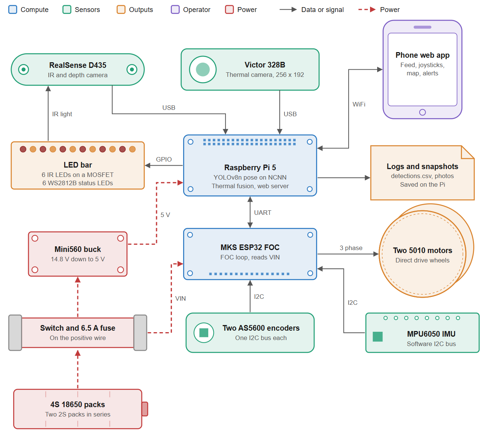

| Part | What it uses | What it does |
|---|---|---|
| **Eyes** | RealSense D435, Victor 328B thermal (256 x 192) | Infrared, depth and heat images |
| **Brain** | Raspberry Pi 5 | Runs YOLOv8n pose on NCNN at 320 x 192, the heat detector and the web server |
| **Muscles** | MKS ESP32 FOC V2.0, 2 x 5010 360KV motors, 2 x AS5600 encoders, MPU6050 IMU | Direct drive wheels under field oriented control |
| **Power** | 4S 18650 pack (two 2S packs), 6.5 A fuse, Mini560 5 V buck | Estimated 2 to 3 hours of runtime |
| **Body** | PETG shell, TPU 95A treads and isolation mounts | Printed body, shaped after the Rainbow Six Siege recon drone |
| **Lights** | LED bar, 6 x 850 nm IR plus 6 x WS2812B | Lights the scene for the camera, shows status |

The operator connects over WiFi from a phone browser, so no app install is needed.

## Test results

The vision tests were run with the drone standing still on its kickstand in a lounge room, with the author as the only person. Each test ran for 10 seconds, about 300 frames.

> **Reading the GIFs:** the test recordings saved one or two frames per run, so most GIFs below step through those real saved frames like a slideshow. The numbers come straight from the test log. Only the last GIF is continuous video. Each green or red bar is the result for that detector across the whole run.

### 1. Hidden people: the main result

The pose model alone finds **nobody** in these seven scenes. The fused detector finds the person in nearly every frame.

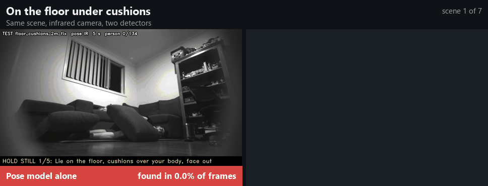

### 2. Why it works: the thermal view

The body shape is lost in infrared, but the heat is still there.

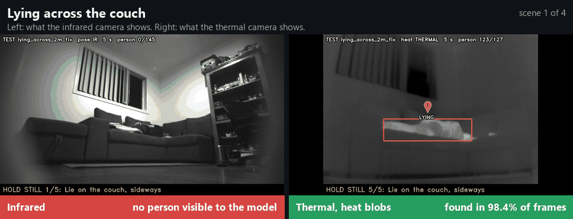

### 3. Empty room: no false alarms

Finding people only matters if the drone does not cry wolf. Pose on the colour camera boxed the couch in up to 43.9% of frames. The fused detector on infrared gave 0 false alarms, even straight after someone sat on the couch and left a warm patch behind.

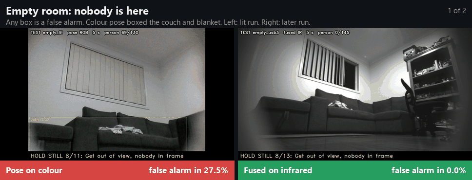

### 4. Plain view and distance

The easy case, plus a tape measure check of the depth reading: 1.01, 1.98 and 2.96 m against 1, 2 and 3 m.

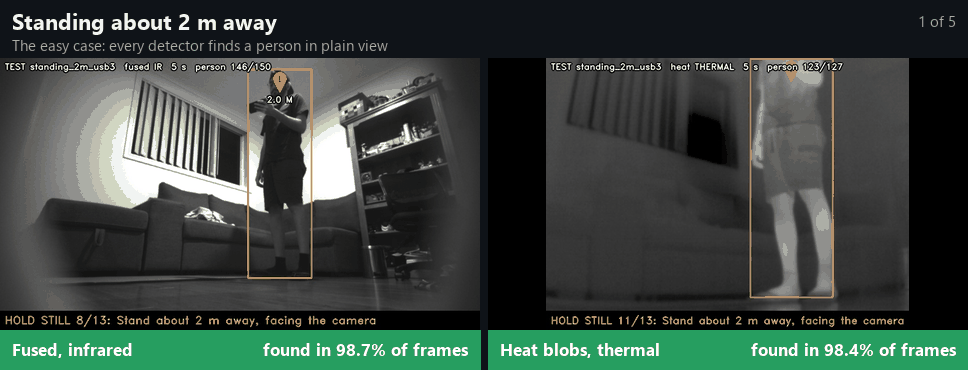

### 5. Where it fails

A blanket over the head as well leaves no warm skin for the heat detector, so nothing is found. This is the one hidden scene that failed.

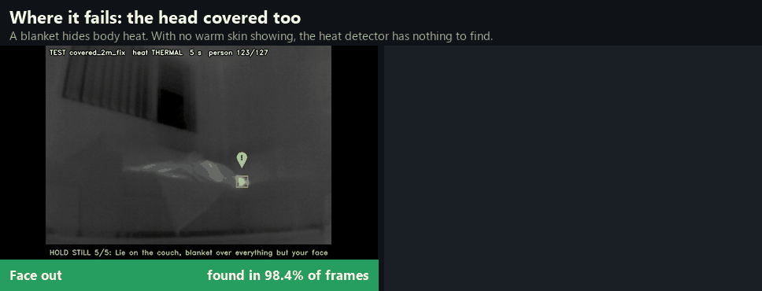

### 6. Where it started

The first prototype in May 2026, running on the bench with depth readings on infrared. It boxes a person walking and lying down, using the pose model alone. There is no heat detector yet, so confidence is often low.

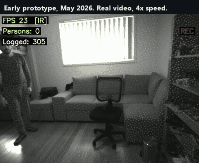

### All the numbers

| Test | Result |
|---|---|
| Standing or sitting, pose on infrared | Up to 99.3% of frames |
| Lying across or half covered, pose on infrared | 0% |
| Heat detector, lit runs | 97.6 to 99.2% |
| Fused detector, hidden scenes | 98.2 to 98.6% |
| Fused detector, feet towards the camera | 50.0% in run 1, 98.2% after the fix |
| Fused detector, head covered | 0% (known limit) |
| False alarms in an empty room, fused | 0 |
| False alarms in an empty room, pose on colour | 27.5 to 43.9% |
| Distance error, USB 3 | 0.04 m or less |
| Pi temperature over 2 hours | 62 to 70 °C at 29 FPS (81 °C with the fan blocked) |

The highest possible rate in these runs is 98.7%, because the 3 of 5 vote needs earlier frames at the start of each test.

**Fixes made from testing:**

- A heat blob under 120 pixels now counts if it is at least 30 pixels and 7 °C above the room. This caught a person under a thin blanket with only the face warm.
- The heat only threshold for lying people dropped from 8.5 to 6 °C. This fixed the feet towards the camera case, where the body read 6.9 °C above the room.
- The warm patch left after sitting peaked at 5.7 °C, so the new threshold still ignores it.

Results are in frames, not people. The fused view can draw two boxes on one body, so boxes are not a head count.

## The build

  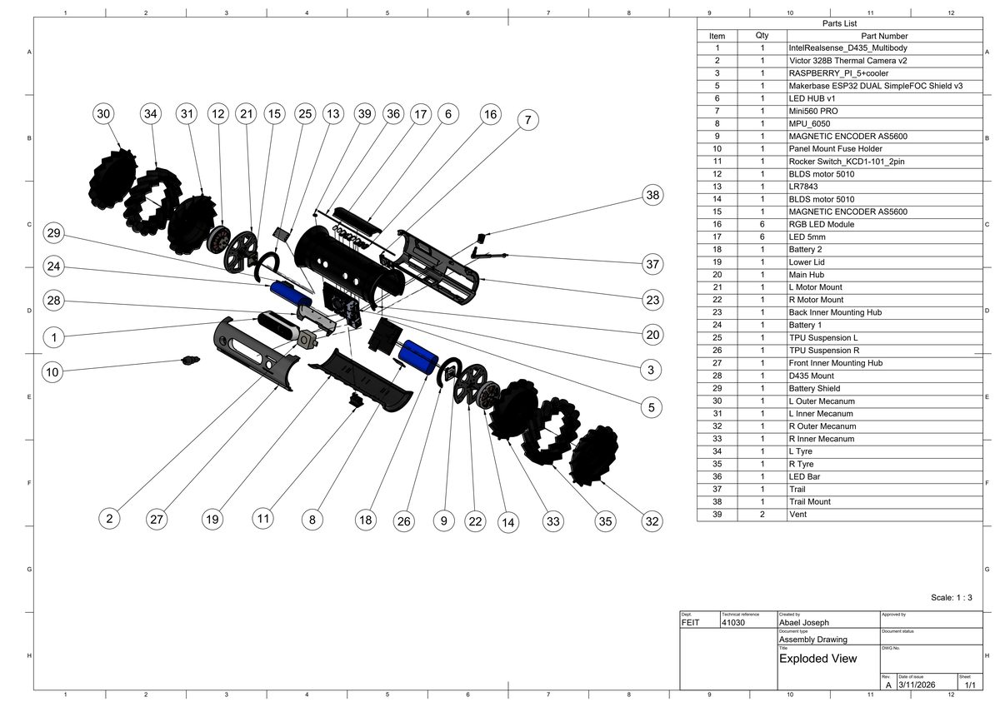

  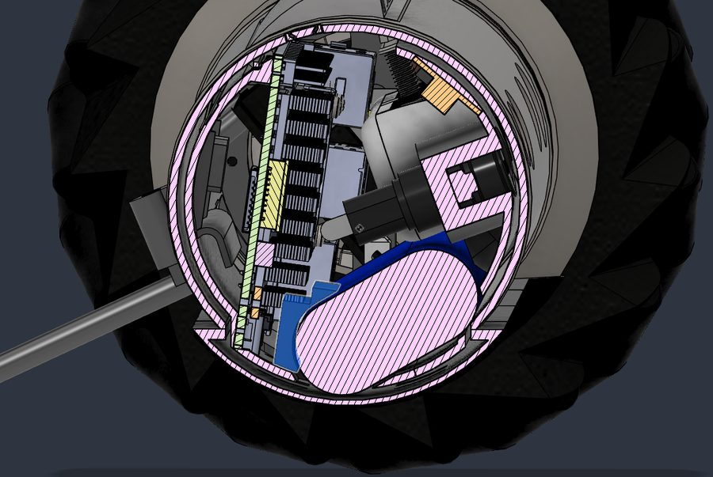
  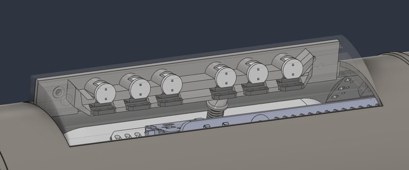

**The big mechanical lesson:** the first design relied on a low centre of mass to keep the body level. The centre of mass ended up only 8 mm below the axle, so when the motors pushed, the body rotated around the axle instead of the drone driving forward. A rear kickstand fixed it. With the kickstand it drives straight and turns on the spot, with tilt held within 3 degrees. Calibrated on wood: wheel 117.8 mm, track 231 mm.

  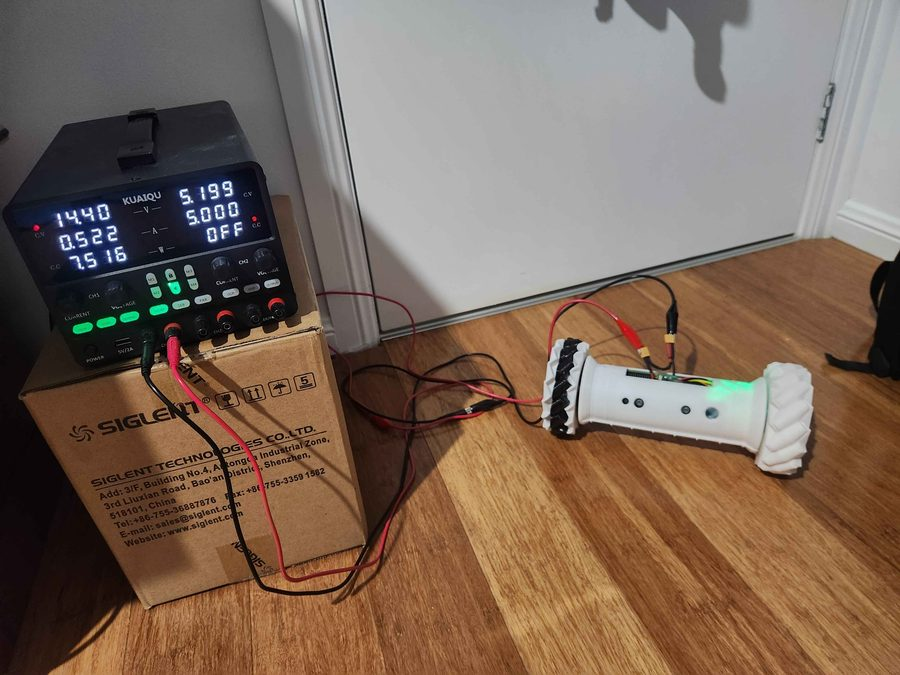
   <em>Drive testing on a bench power supply before going to battery.</em>

## Project status

Status from the final report, measured against the project's [success tiers](docs/SUCCESS_CRITERIA.md).

| Tier | Status |
|---|---|
| Pass: real time AI detection on the Pi | Met |
| Credit: thermal fusion and remote monitoring | Met |
| Distinction: body design and phone streaming | Partly met |
| High Distinction: physical build | Partly met |
| Perfect: stability, 30 FPS, mapping, stop on detect | Partly met |

The map and stop on detect are built, but were not tested with a person on the floor.

**What comes next:**

1. Train the model on infrared and thermal images of people lying down.
2. Lower the centre of mass or fit a proper tail stand.
3. Test with more people, in real rubble.

## What is in this repo

| Path | What it is |
|---|---|
| [`realsense_yolo.py`](realsense_yolo.py) | Early detection app on the D435 |
| [`ncnn_pose.py`](ncnn_pose.py) | YOLOv8n pose on NCNN, used by `web.py` |
| [`realsense_distance.py`](realsense_distance.py) | Depth distance readout |
| [`power_monitor.py`](power_monitor.py), [`usb_check.py`](usb_check.py) | Pi power and USB helpers |
| [`drive/pi/`](drive/pi/) | The code that runs on the drone: `web.py` (detection and server), `web.html` (phone app), `thermal.py`, `drive.py`, `leds.py`, `report_tests.py` (the test script) |
| [`drive/drive_fw/`](drive/drive_fw/) | ESP32 motor firmware |
| [`drive/tools/`](drive/tools/) | Flash and bench test tools |
| `drive/encoder_test/`, `drive/m1_diag/`, `drive/motor_test/` | Motor bring up sketches |
| `yolov8*_ncnn_model/` | Exported NCNN models |
| [`Recon Drone Progress Photos/`](Recon%20Drone%20Progress%20Photos/) | Screenshots from early development |
| [`docs/`](docs/) | Success tiers, plus the images and GIFs used here |

MegaDetector was trialled and dropped from the phone app, so its models are not included. `report_tests.py` needs them for those tests only.
